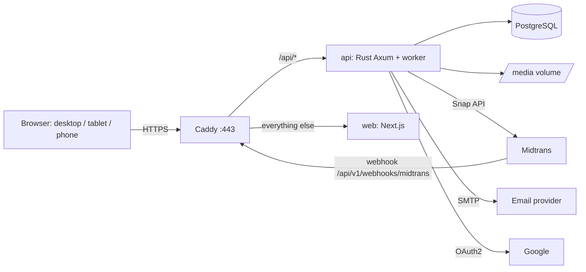

# ARCHITECTURE.md: ShuttleCircle

## 1. Overview



Four containers on one VPS, one Docker Compose file: `caddy`, `web`, `api`, `db`. One origin, so there is no CORS configuration. Only Caddy publishes ports (80, 443).

| Container | Role | Expected idle RAM |
|:---|:---|:---|
| `caddy` | TLS, routing, compression | ~30 MB |
| `api` | HTTP API and background worker in one Rust binary (DEC-006) | < 100 MB |
| `web` | Next.js standalone server (DEC-007) | ~150 MB |
| `db` | PostgreSQL 17 | ~100 MB |

Minimum VPS: 2 GB RAM, 20 GB disk (more if videos are kept, DEC-017).

## 2. Repository layout

```
shuttlecircle/
  api/            Rust crate: src/{main,config,error,auth,matches,requests,settle,wallet,payments,media,admin,notify,worker}.rs
    migrations/   SQLx SQL migrations (0001_init.sql = DATABASE.md §3)
    tests/        integration tests against a real PostgreSQL
  web/            Next.js app
  deploy/         compose.yaml, Caddyfile, .env.example, backup.sh
```

Modules are plain Rust modules in one crate. `settle.rs` holds the single settlement routine (FEATURES.md §2); every caller uses it.

## 3. Frontend

- Next.js App Router, `output: "standalone"`. Pages are client components; data comes from the API in the browser (TanStack Query). No server-side data fetching, because the access token exists only in browser memory.
- On load the app calls `POST /auth/refresh`; success yields an access token, failure falls back to the guest cookie via `GET /me`, and if that also fails the nickname prompt is shown.
- One fetch wrapper adds the bearer header and, on `401`, refreshes once and retries.
- Live state (hold countdown, request status, unread count) is polled: every 5 s on a payment page, every 30 s elsewhere, paused when the tab is hidden. No WebSockets.
- Fonts are self-hosted through `next/font`. Text lives in one Bahasa Indonesia strings file (DEC-019). Money is formatted `Rp 50.000`; times in Asia/Jakarta.
- One responsive layout serves phone, tablet and desktop (DESIGN.md §10). No separate mobile build.

## 4. Background worker

A Tokio task inside the `api` process, ticking every 30 seconds. Each job is a single idempotent SQL-driven step, so a crash or restart loses nothing.

| Job | Action |
|:---|:---|
| Expire holds | `awaiting_payment` past `hold_expires_at` → `expired`, write notification (DEC-003) |
| Close requests of started matches | `pending` / `awaiting_payment` on a match that started → `cancelled` |
| Rewards | For ended, non-cancelled matches with `rewards_processed_at` null: issue rewards (AC-F8-01), then stamp the match |
| Email outbox | Send due `notifications` rows; on failure increase `email_attempts` and push `email_next_at` back (1, 5, 30, 120 min), stop after 5 |
| Housekeeping (hourly) | Delete expired refresh and email tokens; mark stale `pending` payments `expired` |

## 5. Security

- Secrets only in `deploy/.env` on the server (mode 600), never in the repository or images.
- JWT signing key and cookie signing key are separate 32-byte random values.
- Argon2id runs on Tokio's blocking pool.
- All SQL is parameterised (SQLx).
- Uploads: size cap enforced while streaming, type sniffed from content, stored under a random name, never executed, served with `Content-Disposition` and `X-Content-Type-Options: nosniff`.
- Caddy sets HSTS, `X-Frame-Options: DENY`, `Referrer-Policy: strict-origin-when-cross-origin`, and a Content-Security-Policy that allows Midtrans Snap (`app.midtrans.com`, `app.sandbox.midtrans.com`) for script and frame.
- Rate limiting in the API (`tower_governor`), keyed by the client IP that Caddy forwards.
- Midtrans server key stays in the backend; only the client key reaches the browser.
- Logs are structured JSON to stdout and never contain tokens, passwords or full webhook signatures.

## 6. Deployment

### Configuration (`deploy/.env`)

| Variable | Needed for |
|:---|:---|
| `DOMAIN` | Caddy TLS and all absolute links |
| `DATABASE_URL`, `POSTGRES_PASSWORD` | Database |
| `JWT_SECRET`, `COOKIE_SECRET` | Sessions |
| `MIDTRANS_SERVER_KEY`, `MIDTRANS_CLIENT_KEY`, `MIDTRANS_PRODUCTION` | Gateway. Unset → gateway endpoints return `502`, the rest works |
| `GOOGLE_CLIENT_ID`, `GOOGLE_CLIENT_SECRET` | Google sign-in. Unset → button hidden |
| `SMTP_HOST`, `SMTP_PORT`, `SMTP_USER`, `SMTP_PASSWORD`, `MAIL_FROM` | Email. Unset → in-app notifications only, no password reset |
| `MEDIA_DIR` | Media volume path inside `api` |

The API reports which optional features are configured through `GET /api/v1/healthz` (`features: {gateway, google, email}`) so the web app can hide what is unavailable.

### Sandbox (DEC-022)

`deploy/sandbox/` holds the overlay for the dev copy at https://dev.shuttlecircle.personifinn.site: run with `COMPOSE_FILE=compose.yaml:sandbox/compose.sandbox.yaml` and its own `.env`. It only caps memory; email, WhatsApp and Midtrans stay unset. Payment details are seeded with `deploy/seed_payment.sh` (FR-22).

### Build and release (DEC-018)

1. Build `api` and `web` images off the VPS with multi-stage Dockerfiles (`api`: `rust` builder → `debian:stable-slim`; `web`: `node` builder → standalone runtime). Tag with the git commit.
2. Push to a registry (GHCR).
3. On the VPS: `docker compose pull && docker compose up -d`.
4. `api` runs pending SQLx migrations at start, after `deploy/backup.sh` has taken a dump.
5. First install only: register an account on the site, then promote it with `docker compose exec api shuttlecircle create-superadmin --email <email>` (DEC-020).

### External setup

| Service | Setting |
|:---|:---|
| DNS | `A` record for `DOMAIN` → VPS. Without a domain, `<ip>.sslip.io` works and still gets a certificate |
| Midtrans dashboard | Payment notification URL `https://DOMAIN/api/v1/webhooks/midtrans`; enable QRIS |
| Google Cloud console | Authorised redirect URI `https://DOMAIN/api/v1/auth/google/callback` |

### Backup and recovery

- `deploy/backup.sh`, run nightly by host cron and before each release: `pg_dump` (custom format) to `/var/backups/shuttlecircle/`, keep 14 days; copy dumps and the media volume offsite when a target is configured.
- Restore: `pg_restore` into an empty database, restore the media volume, start the stack. Rehearse once before go-live.
- Rollback of a release: redeploy the previous image tag. Migrations are additive; a destructive migration needs its own plan.

### Monitoring

Docker `healthcheck` on `api` (`/healthz`) and `db`, `restart: unless-stopped` on all containers, and one external uptime check on `https://DOMAIN/api/v1/healthz`. Disk usage alert at 80%.

## 7. Testing

- **End-to-end API test** (`deploy/test/e2e.py`, standard-library Python, 124 checks) against the real running stack through Caddy: state machine transitions, role matrix, last-seat concurrency (two parallel approvals, exactly one wins), wallet ledger sum equals balance, webhook signature and idempotency, late payment kept in wallet, hold expiry, reward at the fifth match and not the sixth, match cancellation refund, session rotation and replay.
- Time-dependent rules use the database clock; the test moves time by editing rows with `psql` and waiting for the 30-second worker tick.
- **Midtrans** is replaced in tests by a stub container (`deploy/test/compose.test.yaml`). A real sandbox payment is still to be run once keys exist.
- **Web** (`deploy/test/ui_smoke.cjs`, Playwright with system Chromium): registers through the real form, then walks ten screens at 375, 768 and 1280 px and fails on horizontal overflow, console errors or a missing heading.
- **Unit tests** (`cargo test`): cookie signing, role order, webhook signature.
