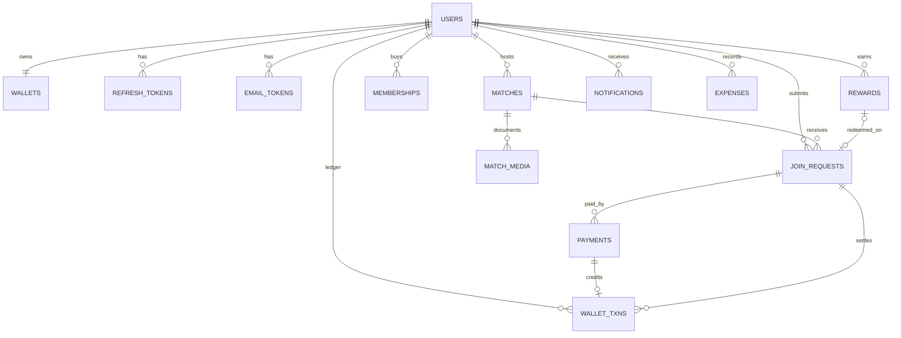

# DATABASE.md: ShuttleCircle

PostgreSQL 17. Accessed from Rust with SQLx; schema managed by SQLx SQL migrations (`migrations/*.sql`). There is no ORM and no Prisma schema: the DDL in §3 is the source of truth and is the content of the first migration.

## 1. ERD



## 2. Rules the schema enforces

| Rule | Mechanism |
|:---|:---|
| Guests are not users (DEC-001) | `join_requests.user_id` is null and `guest_sid` set until conversion |
| Money is whole rupiah | `BIGINT`, no decimals |
| Balance never negative | `CHECK (balance_idr >= 0)` |
| Ledger is append-only | Application never updates or deletes `wallet_txns`; corrections are new `adjustment` rows |
| One gateway credit per payment | Unique index on `wallet_txns(payment_id)` |
| One open request per player per match | Partial unique indexes on `join_requests` |
| One membership per member per month | `UNIQUE (user_id, month)` |
| A reward is redeemed once | `UNIQUE (redeemed_request_id)` |
| Match status is derived | No stored status; only `cancelled_at` |

Capacity is enforced in code, not by a constraint: approval runs `SELECT ... FROM matches WHERE id = $1 FOR UPDATE`, counts requests in `awaiting_payment` or `confirmed`, and only then changes the request. Every wallet change runs `SELECT ... FROM wallets WHERE user_id = $1 FOR UPDATE` first. Lock order is always match, then request, then wallet, to avoid deadlocks.

## 3. Schema (migration `0001_init.sql`)

```sql
CREATE TYPE user_role      AS ENUM ('superadmin','admin','host','member');
CREATE TYPE user_status    AS ENUM ('active','suspended');
CREATE TYPE match_type     AS ENUM ('beginner_friendly','intermediate');
CREATE TYPE request_status AS ENUM ('pending','awaiting_payment','confirmed','rejected','cancelled','expired');
CREATE TYPE payment_method AS ENUM ('membership','reward','wallet','gateway');
CREATE TYPE txn_type       AS ENUM ('topup','manual_credit','match_payment','membership','donation','refund','adjustment');
CREATE TYPE payment_purpose AS ENUM ('topup','match');
CREATE TYPE payment_status AS ENUM ('pending','settled','expired','failed');
CREATE TYPE media_kind     AS ENUM ('photo','video');
CREATE TYPE expense_category AS ENUM ('drinking_water','shuttlecock','other');
CREATE TYPE email_token_purpose AS ENUM ('verify','reset');

CREATE TABLE users (
  id                uuid PRIMARY KEY DEFAULT gen_random_uuid(),
  email             text NOT NULL,              -- stored lowercased
  password_hash     text,                       -- Argon2id; null if Google-only
  google_sub        text,
  full_name         text NOT NULL,
  whatsapp_number   text,
  role              user_role   NOT NULL DEFAULT 'member',
  status            user_status NOT NULL DEFAULT 'active',
  email_verified_at timestamptz,
  created_at        timestamptz NOT NULL DEFAULT now(),
  CHECK (email = lower(email)),
  CHECK (password_hash IS NOT NULL OR google_sub IS NOT NULL)
);
CREATE UNIQUE INDEX users_email_key  ON users(email);
CREATE UNIQUE INDEX users_google_key ON users(google_sub) WHERE google_sub IS NOT NULL;

CREATE TABLE refresh_tokens (
  id          uuid PRIMARY KEY DEFAULT gen_random_uuid(),
  user_id     uuid NOT NULL REFERENCES users(id) ON DELETE CASCADE,
  token_hash  bytea NOT NULL UNIQUE,            -- SHA-256 of the token
  expires_at  timestamptz NOT NULL,
  revoked_at  timestamptz,
  created_at  timestamptz NOT NULL DEFAULT now()
);
CREATE INDEX refresh_tokens_user_idx ON refresh_tokens(user_id);

CREATE TABLE email_tokens (
  token_hash  bytea PRIMARY KEY,
  user_id     uuid NOT NULL REFERENCES users(id) ON DELETE CASCADE,
  purpose     email_token_purpose NOT NULL,
  expires_at  timestamptz NOT NULL,
  used_at     timestamptz
);

-- One row per user, created in the same transaction as the user.
CREATE TABLE wallets (
  user_id     uuid PRIMARY KEY REFERENCES users(id),
  balance_idr bigint NOT NULL DEFAULT 0 CHECK (balance_idr >= 0),
  updated_at  timestamptz NOT NULL DEFAULT now()
);

CREATE TABLE matches (
  id                      uuid PRIMARY KEY DEFAULT gen_random_uuid(),
  host_id                 uuid NOT NULL REFERENCES users(id),
  created_by              uuid NOT NULL REFERENCES users(id),
  title                   text NOT NULL,
  location_name           text NOT NULL,
  location_maps_url       text NOT NULL,
  starts_at               timestamptz NOT NULL,
  duration_hours          int  NOT NULL CHECK (duration_hours BETWEEN 1 AND 12),
  capacity                int  NOT NULL CHECK (capacity >= 1),
  match_type              match_type NOT NULL,
  racket_provided         boolean NOT NULL,
  shuttlecock_provided    boolean NOT NULL,
  equipment_notes         text,
  court_cost_per_hour_idr bigint NOT NULL DEFAULT 0 CHECK (court_cost_per_hour_idr >= 0),
  price_idr               bigint NOT NULL CHECK (price_idr >= 0),
  cancelled_at            timestamptz,
  rewards_processed_at    timestamptz,          -- set by the worker after the match ends
  created_at              timestamptz NOT NULL DEFAULT now()
);
CREATE INDEX matches_starts_at_idx ON matches(starts_at);
CREATE INDEX matches_host_idx      ON matches(host_id);

CREATE TABLE join_requests (
  id              uuid PRIMARY KEY DEFAULT gen_random_uuid(),
  match_id        uuid NOT NULL REFERENCES matches(id),
  user_id         uuid REFERENCES users(id),    -- null while guest
  guest_sid       uuid,                         -- from the sc_guest cookie (DEC-008)
  guest_nickname  text,
  note            text,
  status          request_status NOT NULL DEFAULT 'pending',
  payment_method  payment_method,               -- set when confirmed
  paid_idr        bigint NOT NULL DEFAULT 0,    -- wallet amount debited; basis for refund
  hold_expires_at timestamptz,                  -- set while awaiting_payment
  games_played    int CHECK (games_played >= 0),
  decided_by      uuid REFERENCES users(id),
  created_at      timestamptz NOT NULL DEFAULT now(),
  updated_at      timestamptz NOT NULL DEFAULT now(),
  CHECK (user_id IS NOT NULL OR guest_sid IS NOT NULL)
);
CREATE INDEX jr_match_status_idx ON join_requests(match_id, status);
CREATE INDEX jr_user_idx         ON join_requests(user_id);
CREATE INDEX jr_guest_idx        ON join_requests(guest_sid) WHERE user_id IS NULL;
CREATE INDEX jr_hold_idx         ON join_requests(hold_expires_at) WHERE status = 'awaiting_payment';
CREATE UNIQUE INDEX jr_open_per_user ON join_requests(match_id, user_id)
  WHERE status IN ('pending','awaiting_payment','confirmed');
CREATE UNIQUE INDEX jr_open_per_guest ON join_requests(match_id, guest_sid)
  WHERE user_id IS NULL AND status IN ('pending','awaiting_payment','confirmed');

-- One row per Midtrans transaction. order_id sent to Midtrans is 'SC-' || id.
CREATE TABLE payments (
  id              uuid PRIMARY KEY DEFAULT gen_random_uuid(),
  user_id         uuid NOT NULL REFERENCES users(id),
  purpose         payment_purpose NOT NULL,
  join_request_id uuid REFERENCES join_requests(id),
  amount_idr      bigint NOT NULL CHECK (amount_idr > 0),
  status          payment_status NOT NULL DEFAULT 'pending',
  snap_token      text,
  redirect_url    text,
  expires_at      timestamptz NOT NULL,
  last_notification jsonb,                      -- last Midtrans payload, for audit
  created_at      timestamptz NOT NULL DEFAULT now(),
  settled_at      timestamptz,
  CHECK ((purpose = 'match') = (join_request_id IS NOT NULL))
);
CREATE INDEX payments_user_idx ON payments(user_id, created_at);
CREATE INDEX payments_jr_idx   ON payments(join_request_id);

CREATE TABLE wallet_txns (
  id              uuid PRIMARY KEY DEFAULT gen_random_uuid(),
  user_id         uuid NOT NULL REFERENCES wallets(user_id),
  amount_idr      bigint NOT NULL CHECK (amount_idr <> 0),   -- + credit, − debit
  txn_type        txn_type NOT NULL,
  payment_id      uuid REFERENCES payments(id),              -- for gateway top-ups
  join_request_id uuid REFERENCES join_requests(id),         -- for match_payment / refund
  note            text,                                      -- required for manual_credit, adjustment
  created_by      uuid REFERENCES users(id),                 -- acting admin, if any
  created_at      timestamptz NOT NULL DEFAULT now()
);
CREATE INDEX wallet_txns_user_idx ON wallet_txns(user_id, created_at);
CREATE INDEX wallet_txns_type_idx ON wallet_txns(txn_type, created_at);
CREATE UNIQUE INDEX wallet_txns_payment_key ON wallet_txns(payment_id) WHERE payment_id IS NOT NULL;

CREATE TABLE memberships (
  id            uuid PRIMARY KEY DEFAULT gen_random_uuid(),
  user_id       uuid NOT NULL REFERENCES users(id),
  month         date NOT NULL CHECK (extract(day FROM month) = 1),  -- first day, Asia/Jakarta
  price_idr     bigint NOT NULL,
  wallet_txn_id uuid NOT NULL REFERENCES wallet_txns(id),
  created_at    timestamptz NOT NULL DEFAULT now(),
  UNIQUE (user_id, month)
);

CREATE TABLE rewards (
  id                  uuid PRIMARY KEY DEFAULT gen_random_uuid(),
  user_id             uuid NOT NULL REFERENCES users(id),
  earned_match_id     uuid NOT NULL REFERENCES matches(id),   -- the fifth match
  counted_until       timestamptz NOT NULL,   -- end of the fifth match; earlier matches no longer count
  expires_at          timestamptz NOT NULL,   -- counted_until + 1 month
  redeemed_request_id uuid UNIQUE REFERENCES join_requests(id),
  created_at          timestamptz NOT NULL DEFAULT now(),
  UNIQUE (user_id, earned_match_id)
);
CREATE INDEX rewards_user_idx ON rewards(user_id);

CREATE TABLE match_media (
  id          uuid PRIMARY KEY DEFAULT gen_random_uuid(),
  match_id    uuid NOT NULL REFERENCES matches(id),
  uploaded_by uuid NOT NULL REFERENCES users(id),
  kind        media_kind NOT NULL,
  path        text NOT NULL,                  -- relative to the media volume
  size_bytes  bigint NOT NULL,
  created_at  timestamptz NOT NULL DEFAULT now()
);
CREATE INDEX match_media_match_idx ON match_media(match_id);

CREATE TABLE expenses (
  id          uuid PRIMARY KEY DEFAULT gen_random_uuid(),
  category    expense_category NOT NULL,
  amount_idr  bigint NOT NULL CHECK (amount_idr > 0),
  spent_on    date NOT NULL,
  note        text,
  created_by  uuid NOT NULL REFERENCES users(id),
  created_at  timestamptz NOT NULL DEFAULT now()
);
CREATE INDEX expenses_spent_on_idx ON expenses(spent_on);

-- In-app notifications and the email outbox in one table.
CREATE TABLE notifications (
  id             uuid PRIMARY KEY DEFAULT gen_random_uuid(),
  user_id        uuid NOT NULL REFERENCES users(id),
  kind           text NOT NULL,
  payload        jsonb NOT NULL DEFAULT '{}',
  read_at        timestamptz,
  email_sent_at  timestamptz,
  email_attempts int NOT NULL DEFAULT 0,
  email_next_at  timestamptz DEFAULT now(),   -- null = do not email
  wa_sent_at     timestamptz,                 -- WhatsApp copy tried (migration 0002); null = not yet
  created_at     timestamptz NOT NULL DEFAULT now()
);
CREATE INDEX notifications_user_idx   ON notifications(user_id, created_at DESC);
CREATE INDEX notifications_outbox_idx ON notifications(email_next_at)
  WHERE email_sent_at IS NULL AND email_next_at IS NOT NULL;

-- Exactly one row.
CREATE TABLE settings (
  id                   boolean PRIMARY KEY DEFAULT true CHECK (id),
  reward_enabled       boolean NOT NULL DEFAULT true,
  membership_price_idr bigint CHECK (membership_price_idr > 0),   -- null = membership not sold
  min_topup_idr        bigint NOT NULL DEFAULT 10000 CHECK (min_topup_idr > 0)
);
INSERT INTO settings DEFAULT VALUES;
```

## 4. Key queries

**Seats taken** (calendar and approval):
```sql
SELECT count(*) FROM join_requests
WHERE match_id = $1 AND status IN ('awaiting_payment','confirmed');
```

**Attended matches of a user** (history, reward; DEC-012):
```sql
SELECT m.* FROM join_requests jr JOIN matches m ON m.id = jr.match_id
WHERE jr.user_id = $1 AND jr.status = 'confirmed'
  AND m.cancelled_at IS NULL
  AND m.starts_at + make_interval(hours => m.duration_hours) <= now();
```

**Reward check** for a user after match M ends at `E` (AC-F8-01): count attended matches whose end lies in `(greatest(E − interval '2 months', last reward's counted_until), E]`. If the count is ≥ 5, insert a reward with `counted_until = E`, `expires_at = E + interval '1 month'`.

**Hold expiry** (worker, every 30 s):
```sql
UPDATE join_requests SET status = 'expired', updated_at = now()
WHERE status = 'awaiting_payment' AND hold_expires_at <= now()
RETURNING id, user_id, match_id;
```

**Finance summary** for a range (AC-F10-01):

| Figure | Source |
|:---|:---|
| Cash in | `wallet_txns` sum where `txn_type IN ('topup','manual_credit')` |
| Fee income | `−sum` of `match_payment` plus `refund` |
| Membership income | `−sum` of `membership` |
| Donations | `−sum` of `donation` |
| Court costs | `sum(court_cost_per_hour_idr * duration_hours)` of non-cancelled matches that started in range |
| Other expenses | `expenses` sum by category |
| Member balances | `sum(wallets.balance_idr)` (current, not ranged) |

## 5. Retention and backup

Nothing is purged. The admin 3-month history (FR-12) is a query filter. Backups: see ARCHITECTURE.md §6. Media files are not in the database and are backed up separately.
