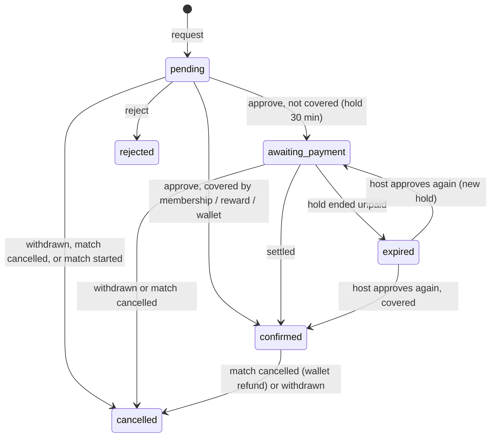

# FEATURES.md: ShuttleCircle

## 1. Feature Module Map

| Module | Primary Roles | Decisions | Related Spec |
|:---|:---|:---|:---|
| F1 Identity & Session | Guest, Member | DEC-001, DEC-004, DEC-008, DEC-020 | API.md §3.1 |
| F2 Match Calendar | All | DEC-019 | API.md §3.2 |
| F3 Match Configuration | Host, Admin | DEC-016 | API.md §3.2 |
| F4 Join Request & Approval | All | DEC-002, DEC-003, DEC-009 | API.md §3.3 |
| F5 Payment & Seat Hold | Member | DEC-002, DEC-003, DEC-004, DEC-010 | API.md §3.3, §3.5 |
| F6 Wallet, Membership, Donation | Member, Admin, Superadmin | DEC-005, DEC-013, DEC-014 | API.md §3.4 |
| F7 Match History & Media | Host, Admin, Member | DEC-012, DEC-017 | API.md §3.6 |
| F8 Reward Engine | Member | DEC-015 | DATABASE.md `rewards` |
| F9 Notifications | Members | DEC-011 | ARCHITECTURE.md §4 |
| F10 Finance Dashboard & Admin | Admin, Superadmin | DEC-023 | API.md §3.7 |
| F11 Court Rotation (latest) | Host, Admin; Members read-only | DEC-021 | API.md §3.9 |

Field names in this file match `DATABASE.md` and `API.md`.

## 2. Join Request State Machine

This is the single source for request states. Other documents use these names.

- A seat is taken by `awaiting_payment` and `confirmed` requests. `taken ≤ capacity` always.
- `expired` is the automatic cancellation of DEC-003. Nothing is promoted automatically.
- **Settlement** is one backend routine, run on approval, on guest conversion, on a manual credit, on `pay`, and on a gateway webhook. It tries, in order: active membership for the match month, unused unexpired reward, wallet balance ≥ price. On success the request becomes `confirmed` and `payment_method` records which one paid.

## 3. F1 — Identity & Session

### User Stories
- As a guest, I enter a nickname and immediately browse and request to join a match without an account.
- As a member, I sign in with Google or email + password and keep my history across devices.
- As an approved guest, I am prompted to create an account so I can pay and keep history (DEC-001, DEC-004).

### Acceptance Criteria
| ID | Criterion |
|:---|:---|
| AC-F1-01 | The guest cookie `sc_guest` is signed, `HttpOnly`, `Secure`, `SameSite=Lax`, 30 days, and carries `sid` and `nickname`. No `users` row is created for a guest. |
| AC-F1-02 | A guest join request stores `guest_sid` and `guest_nickname`. Without the cookie the guest identity is lost; open guest requests close when the match starts. |
| AC-F1-03 | Member auth issues an access JWT (15 min, held in browser memory) and a refresh token (7 days, rotated on use, `HttpOnly` cookie, stored hashed). Passwords use Argon2id, minimum 8 characters. |
| AC-F1-04 | An approved guest sees a blocking conversion prompt with the hold countdown and cannot reach payment (DEC-004). |
| AC-F1-05 | On register or sign-in while `sc_guest` is present, open requests with that `guest_sid` are linked to the user, the cookie is cleared, and settlement runs for held requests. |
| AC-F1-06 | Google sign-in with a verified email that matches an existing account signs into that account. If that account's email was never verified, its password is removed. |
| AC-F1-07 | Password reset and email verification use single-use emailed links (1 hour and 24 hours). Verification does not block use of the app. Without SMTP configured, reset is unavailable. |
| AC-F1-08 | The first superadmin is created by a server command. Roles change only through the superadmin user screen (DEC-020). |
| AC-F1-09 | A suspended user cannot sign in or refresh. Role and status changes take effect within 15 minutes (access token lifetime). |

### Edge Cases
- Email already registered during conversion → show "sign in instead"; signing in links the request (AC-F1-05).
- Linked request duplicates a request the member already has for that match → the guest request is cancelled.
- OAuth2 `state` mismatch → callback rejected, no session issued.
- Reused (already rotated) refresh token → all of that user's refresh tokens are revoked.

## 4. F2 — Match Calendar

### User Stories
- As any role, I view matches on a calendar spanning 1 month back to 3 months ahead.
- As any role, I open a match and tap the location to get Google Maps directions.

### Acceptance Criteria
| ID | Criterion |
|:---|:---|
| AC-F2-01 | The API clamps the requested range to `[today − 1 month, today + 3 months]` silently; matches outside it are never returned. |
| AC-F2-02 | Each match shows status, type, capacity, seats remaining (`capacity − taken`), price and equipment. |
| AC-F2-03 | `status` is computed, not stored: `cancelled` if `cancelled_at` is set, else `scheduled` before `starts_at`, `ongoing` until `starts_at + duration_hours`, then `completed`. Server clock only. |
| AC-F2-04 | Location opens `location_maps_url` in a new tab for all roles including guest. |
| AC-F2-05 | Times display in Asia/Jakarta; the API sends UTC. |
| AC-F2-06 | Calendar p95 API < 300 ms; no pagination (the window holds at most four months). |

### Edge Cases
- A visitor with neither cookie nor login opens a shared match link → nickname prompt, then the match.
- A match with no confirmed players still appears as `scheduled`.

## 5. F3 — Match Configuration

### User Stories
- As a host or admin, I create a match with title, start, location, duration, capacity, type, equipment, court cost and price.
- As an admin, I assign a host; if none is selected, I am the host (FR-06).

### Acceptance Criteria
| ID | Criterion |
|:---|:---|
| AC-F3-01 | Required: `title`, `starts_at` (future), `duration_hours` (1–12), `location_name`, `location_maps_url` (https), `capacity` (≥ 1), `match_type`, `racket_provided`, `shuttlecock_provided`, `price_idr` (≥ 0), `court_cost_per_hour_idr` (≥ 0). Optional: `equipment_notes`. |
| AC-F3-02 | Seats taken never exceed `capacity`; approval locks the match row to enforce this. |
| AC-F3-03 | A host may set only themselves as host and edit only own matches. Admins and superadmins may assign any user with role host or higher and edit any match. |
| AC-F3-04 | After any request is `awaiting_payment` or `confirmed`, `price_idr` cannot change. |
| AC-F3-05 | A started or cancelled match cannot be edited, except `games_played` and media. |

### Edge Cases
- Reducing capacity below seats taken → 409.
- Cancelling a match → superadmin only; open requests become `cancelled`; confirmed players are refunded to wallet, a used reward is restored, and all are notified (DEC-016).

## 6. F4 — Join Request & Approval

### User Stories
- As any role, I request to join a scheduled match.
- As host, admin or superadmin, I approve or reject requests from a request list.

### Acceptance Criteria
| ID | Criterion |
|:---|:---|
| AC-F4-01 | States and transitions follow §2. |
| AC-F4-02 | Approval is manual by the match host, an admin or a superadmin; nothing is approved or promoted automatically (DEC-003). |
| AC-F4-03 | Approval runs settlement in the same transaction. If not covered, the request becomes `awaiting_payment` with `hold_expires_at = now + 30 min` (DEC-002, DEC-009). |
| AC-F4-04 | Requests are accepted while a match is `scheduled`, even when full, so the host has a queue to approve from when a seat frees up. Approval fails with 409 when no seat is free. |
| AC-F4-05 | One open request (`pending`, `awaiting_payment`, `confirmed`) per player per match. |
| AC-F4-06 | A requester can withdraw their own `pending` or `awaiting_payment` request. |
| AC-F4-07 | Rejection and approval notify a member requester; a guest sees the status on the site. |
| AC-F4-08 | A guest can hold at most 3 open requests. |

### Edge Cases
- Two approvers act on the same request at once → the second receives 409; the transition is guarded by the current status.
- Two approvals compete for the last seat → one succeeds, the other receives 409.
- Request on a started, completed or cancelled match → 409.
- Match starts with requests still `pending` or `awaiting_payment` → the worker cancels them.

## 7. F5 — Payment & Seat Hold

### User Stories
- As an approved member covered by membership, reward or wallet, I am confirmed immediately.
- As an approved member not covered, I pay by QR within 30 minutes while my seat is held.

### Acceptance Criteria
| ID | Criterion |
|:---|:---|
| AC-F5-01 | Covered at approval → `confirmed`; a wallet payment writes one `match_payment` ledger entry. |
| AC-F5-02 | Not covered → `awaiting_payment` for exactly 30 minutes from approval (DEC-002). |
| AC-F5-03 | The player starts payment from their own request page. The backend first retries settlement, then creates a Midtrans Snap transaction for the full `price_idr`, expiring when the hold expires. |
| AC-F5-04 | A verified settlement webhook credits the player's wallet, then runs settlement; the request becomes `confirmed` and a confirmation is sent. All in one transaction. |
| AC-F5-05 | When the hold ends unpaid the worker sets `expired` and notifies the player; no other request is promoted (DEC-003). |
| AC-F5-06 | A guest cannot create a payment; the request must first be linked to a member (DEC-004). |
| AC-F5-07 | Webhooks are verified by signature and amount, and are idempotent per `order_id`. |

### Edge Cases
- Payment settles after the hold expired or the seat was taken → the money stays in the wallet as a top-up; the player is notified.
- Duplicate webhook → acknowledged, no second credit.
- Gateway down → the player sees a retry message; an admin manual credit (DEC-005) settles the held seat at once.
- Player pays, and an admin also credits manually → the surplus stays in the wallet.

### Manual payment (FR-22, DEC-024, added 2026-11-22)
| ID | Criterion |
|:---|:---|
| AC-F5-M1 | **Bayar** on a held request and **Top-up** on the Wallet page open the payment dialog: amount, QRIS image (if set), e-wallet number and names, bank accounts with copy buttons, holder name (if set). No gateway page is opened. |
| AC-F5-M2 | **Saya sudah bayar** creates a payment claim (`amount_idr`, `method` from the shown methods, optional note, the held request if any). At most 5 pending claims per member. All active admins and superadmins get a `payment_claim` notification. |
| AC-F5-M3 | Admin > Pembayaran lists pending claims. **Konfirmasi** runs the manual-credit path (ledger `manual_credit` with note "Pembayaran <method> dikonfirmasi", then held seats settle from the wallet). **Tolak** changes nothing in the wallet and notifies the member. A claim is decided once (`409 ALREADY_PROCESSED`). |
| AC-F5-M4 | Only a superadmin edits payment details: e-wallet number (5 to 30 digits), e-wallet names, up to 10 bank accounts (name required, 5 to 30 digits), holder name, and the QRIS image (JPEG, PNG or WebP by content, at most 3 MB). |
| AC-F5-M6 | **Tandai lunas** (added 2026-11-26, DEC-026): on the match page an admin or superadmin confirms a held (`awaiting_payment`) or expired request as paid outside the app, for members and guests, with no claim and no wallet movement. The request becomes `confirmed` with `payment_method = cash`, `paid_idr` = match price and `paid_at` = now; a member gets a `payment_confirmed` notification. An expired request takes a seat only if the match is open and has room (`409 MATCH_NOT_OPEN` / `MATCH_FULL`); other states give `409 ALREADY_PROCESSED`; hosts and members get `403`. The amount counts in the finance dashboard's cash in and match fees on the day it was marked. |
| AC-F5-M5 | The real account numbers and QRIS image are never committed. They are loaded per site with `deploy/seed_payment.sh` from the ignored `deploy/payment.local.json` and `deploy/payment-qris.local.*` (template: `deploy/payment.example.json`), or typed in Admin > Pembayaran. |

Edge case: the 30-minute hold can end before an admin confirms. The confirmed money then stays in the wallet (as with a late gateway payment, DEC-010) and the host approves again, which settles from the wallet.

## 8. F6 — Wallet, Membership, Donation

### User Stories
- As a member, I top up my wallet through the gateway.
- As an admin, I credit a member's wallet for cash received offline (DEC-005).
- As a member, I buy a monthly membership or donate toward shuttlecocks from my wallet.

### Acceptance Criteria
| ID | Criterion |
|:---|:---|
| AC-F6-01 | Every balance change is one append-only ledger entry. `wallets.balance_idr` is updated in the same transaction and always equals the ledger sum. |
| AC-F6-02 | A gateway top-up credits the wallet only on a verified settlement webhook. Starting a top-up writes no ledger entry. |
| AC-F6-03 | A manual credit needs a positive amount and a reason, records the acting admin, and then runs settlement for that member's held requests. |
| AC-F6-04 | Balance can never go negative; an insufficient debit fails. |
| AC-F6-05 | A superadmin can post a signed adjustment with a reason to correct mistakes. Ledger entries are never edited or deleted. |
| AC-F6-06 | Membership: one per member per calendar month, bought from the wallet at the price in settings; unavailable while the price is unset (DEC-013). |
| AC-F6-07 | Donation: any positive amount up to the balance, debited from the wallet (DEC-014). |
| AC-F6-08 | Top-up amount is at least the configured minimum (default Rp 10.000). |

### Edge Cases
- Credit to an unknown member → 404.
- Membership bought after a seat in that month was already paid → no retroactive refund.

## 9. F7 — Match History & Media

### User Stories
- As an admin, I view all match history for 3 months.
- As a member, I view only matches I attended, with the player list and games per player.
- As host or admin, I upload photos and videos as documentation.

### Acceptance Criteria
| ID | Criterion |
|:---|:---|
| AC-F7-01 | Attended = `confirmed` request on a match that ended and was not cancelled (DEC-012). |
| AC-F7-02 | Admin history lists completed matches of the last 3 months; member history lists attended matches with no time limit. Both are query filters; nothing is deleted. |
| AC-F7-03 | History detail lists confirmed players and `games_played` per player, entered by the match host or an admin after the match starts. |
| AC-F7-04 | Media upload and delete: the match host, admins, superadmins. View: players who attended, the host, admins. |
| AC-F7-05 | Files live on a server volume outside the containers; the database stores the path. Photos ≤ 10 MB (JPEG, PNG, WebP), videos ≤ 100 MB (MP4), at most 30 files per match. Type is checked from file content, not only the name (DEC-017). |

### Edge Cases
- Upload by anyone else → 403.
- Oversized or wrong-type file → 422.

## 10. F8 — Reward Engine

### User Stories
- As a member attending 5 matches within 2 months, I earn 1 free seat valid 1 month from the fifth match.

### Acceptance Criteria
| ID | Criterion |
|:---|:---|
| AC-F8-01 | After a match ends, the worker checks each attendee: if they have 5 attended matches within the 2 months ending at this match, none of them already counted for an earlier reward, a reward is issued. |
| AC-F8-02 | The reward expires 1 month after the fifth match's end. It is used at approval time, before the wallet is charged (DEC-015). |
| AC-F8-03 | An admin can switch issuing on or off. Switching off does not remove rewards already earned. |
| AC-F8-04 | A redeemed reward confirms one seat with no charge and is recorded on the request (`payment_method = reward`). |
| AC-F8-05 | A member is notified when a reward is earned. |

### Edge Cases
- A match paid with a reward is cancelled → the reward becomes unused again.
- An expired reward is simply ignored by settlement.

## 11. F9 — Notifications

### Acceptance Criteria
| ID | Criterion |
|:---|:---|
| AC-F9-01 | Events: request approved (with hold deadline if payment is due), request rejected, payment confirmed, hold expired, late payment kept in wallet, match cancelled, reward earned, manual credit received. |
| AC-F9-02 | Channels: in-app list with unread count, and email (DEC-011). |
| AC-F9-03 | A notification row is written in the same transaction as the event. Email is sent afterwards by the worker and never blocks or rolls back the payment. |
| AC-F9-04 | Failed email is retried up to 5 times with growing delay; the outcome is stored. |

### Edge Cases
- SMTP not configured → in-app only.
- Guest → no notifications; the request page shows the live status.

## 12. F10 — Finance Dashboard & Admin

### Acceptance Criteria
| ID | Criterion |
|:---|:---|
| AC-F10-01 | For a date range the dashboard shows: cash in (gateway top-ups + manual credits), fee income, membership income, donations, court costs (`court_cost_per_hour_idr × duration_hours` of matches that ran), other expenses, and current total member wallet balance. |
| AC-F10-02 | Superadmins add and delete expenses with category (`drinking_water`, `shuttlecock`, `other`), amount, date and note. |
| AC-F10-03 | Superadmins search users and change role and status. A superadmin cannot demote or suspend themselves. |
| AC-F10-04 | Admins search members and view any member's wallet and ledger. |
| AC-F10-05 | Settings: reward on/off (admin), membership price and minimum top-up (superadmin). |
| AC-F10-06 | The Wallet page of an admin or superadmin shows the club finance dashboard for a date range (default: this month to date): a pie of income (fee + membership + donation), outcome (court cost + all expense categories), current total member balance and the absolute ledger discrepancy, each with its amount and share; net = income − outcome. Members do not see it. |
| AC-F10-07 | Discrepancy = sum of all `wallet_txns` − sum of all wallet balances, all time. 0 shows "Sesuai"; anything else shows "Perlu dicek". |
| AC-F10-08 | Bar chart of players joined for the last 12 weeks (Monday start) or 12 months, switchable: bar = distinct players with a confirmed seat in matches starting in the period; hover and the table view also give confirmed seats and new accounts. |
| AC-F10-09 | **Unduh Excel** downloads `shuttlecircle-laporan-<from>-<to>.xlsx` with sheets Ringkasan, Buku besar, Pengeluaran, Pemain per minggu, Pemain per bulan. **Cetak / simpan PDF** prints only the dashboard (the browser's Save as PDF makes the file). |

## 13. F11 — Court Rotation (latest feature)

Added 2026-11-19 (FR-19, DEC-021). The rules follow the behaviour of a common court-queue tool for social badminton: fewest games first, longest wait next, and newcomers do not jump the queue.

### Flow
1. The host arranges a match as usual. Every confirmed player (FR-11) appears on the match's rotation board as "not arrived". No extra setup is needed.
2. At the venue the host marks players as arrived, one by one or all at once. The board starts with 2 courts in doubles; the host can change both.
3. For each court the host taps **Pilihkan pemain**. The system picks the next players by the rules below, splits them into two teams, and shows them as that court's next turn. The host can pick again, choose players by hand, or clear the turn.
4. **Mulai** starts the game and its timer. Meanwhile the host can already prepare the court's following turn.
5. While the game runs, the host taps **+1** for the team that won each rally (**−1** undoes). The board shows **Match point** when a team is one rally from winning and the winner when the game is decided.
6. **Selesai** ends the game; the live score is kept (or typed in if no one kept score). Every player in it gets one more game and starts waiting again. Their `games_played` on the roster is updated (FR-12).
7. Players can rest, return or leave at any time, except while on court.
8. The match leaderboard ranks everyone who has finished a game.

### User Stories
- As a host, I want the system to pick who plays next, so that everyone gets about the same number of games and nobody waits too long.
- As a host, I want mixed-doubles or men-only courts and level-balanced games, so that the games match the session.
- As a member, I want to see the board on my phone, so that I know when it is my turn.

### Acceptance Criteria
| ID | Criterion |
|:---|:---|
| AC-F11-01 | The board lists exactly the match's confirmed players. Only the match host, admins and superadmins change it; any signed-in member can view it. A cancelled match has no board. |
| AC-F11-02 | Queue order: fewest counted games, then longest waiting since the last game end, arrival or return from rest, then earliest arrival. Counted games = max(games played, the fewest games among the other players present when this player arrived or returned). |
| AC-F11-03 | Picking takes the first 4 (doubles) or 2 (singles) eligible players in queue order who are waiting and not already in another court's turn. Fewer eligible players → `409 NOT_ENOUGH_PLAYERS` with the number missing. |
| AC-F11-04 | Teams: queue positions 1 and 4 against 2 and 3. Singles: 1 against 2. |
| AC-F11-05 | Gender mode per court: any (everyone, including players with no gender set); mixed (doubles only, 2 men and 2 women, one of each per team); men; women. |
| AC-F11-06 | Level mode per court: off; balanced (similar levels); mixed (spread levels). Level only chooses among players with the same counted games as the last player needed, so a player who played more never goes ahead. An unset level counts as beginner. When level is on, teams are strongest + weakest against the middle two. |
| AC-F11-07 | A court has at most one next turn and one running game. A next turn cannot start while the court's game is running. Picking again replaces the court's next turn. |
| AC-F11-08 | A host can choose the players by hand from waiting players; the screen warns when the choice skips a player with fewer counted games. |
| AC-F11-09 | Finishing a game adds one game to each of its players, sets their wait start to now, stores the optional score, and sets `join_requests.games_played` to the player's finished rotation games. Scores of finished games can be edited later. |
| AC-F11-10 | Rest or leave removes the player from the queue; if they were in a next turn, that turn is cleared. A player on court cannot rest or leave. A player with finished games cannot be marked as not arrived. |
| AC-F11-11 | Number of courts 1 to 20, format doubles or singles. A court with a next turn or running game cannot be removed, and the format cannot change while any turn is open. |
| AC-F11-12 | All changes run in one transaction that locks the match row, so two hosts tapping at once cannot double-book a player. The board refreshes every 10 seconds. |
| AC-F11-13 | Live score (BWF single game): a team wins at 21 with a 2-point lead, or at 30. Match point is shown for every team one rally from winning (both at 29–29). A point after the game is won is rejected (`409 GAME_DECIDED`); −1 never goes below 0. Only a running game takes live points. Finishing without a score keeps the live score. |
| AC-F11-14 | Leaderboard per match: every player with a finished game, with games, wins, losses, points for, points against and difference. Order: wins, difference, points for, name. A finished game without a score counts as played only. A typed-in finished score is won by the higher score, so shorter formats still count. |
| AC-F11-15 | Scoring format per match (FR-23): sets per game 1, 3 or 5 (best of); points per set 1 to 99; maximum points between the points per set and 99 (equal = no deuce). Default 1 set, 21 points, maximum 30. A set is won at the points with a 2-point lead, or at the maximum. A game takes the format when it starts and keeps it if the format changes later. Only the host, admins and superadmins change it (`403` for others, `422` for other values). |
| AC-F11-16 | Sets: a won set moves into the game's set list and the next set starts at 0–0. The game is won by the majority of sets (2 of 3, 3 of 5); after that, points are rejected (`409 GAME_DECIDED`). −1 at 0–0 reopens the last set. Game point = one rally from winning the set; match point = one rally from winning the game. |
| AC-F11-17 | Full-screen counter: **Layar penuh** on a running game shows the blue team (A) and the red team (B) as two halves, stacked on a portrait phone and side by side in landscape or on a computer. The host taps a half for +1 and the round −1 button to undo; members see the same screen read-only. The screen asks the browser for full screen and keeps the display awake where supported. **Simpan hasil** asks for confirmation and saves the result with every set; **Keluar** closes the screen without saving. Finishing or editing a result from the board takes the score set by set. The board refreshes every 3 seconds while any game runs. |

### Edge Cases
- A player arrives late or returns from rest → counted games are raised to the current minimum, so they wait behind those who have waited longer.
- A guest request is confirmed only after conversion (DEC-004), so every rotation player has an account and a name.
- Two scorers tap at once → both taps are counted in order (the match row is locked per tap).
- A host's manual `games_played` entry is overwritten when that player finishes another rotation game.

### Not included
Not taken from the reference tool: one shared group queue for any free court, court renaming, pasting names from WhatsApp (the roster comes from confirmed requests), and local backup files (the board is stored on the server).

## 14. Out of Scope (Feature Level)

Native mobile apps, multi-tenancy, automated waiting-list promotion, double-entry accounting, social chat, gateway refunds, PWA/offline, WhatsApp, no-show tracking. See PRD.md §10.
