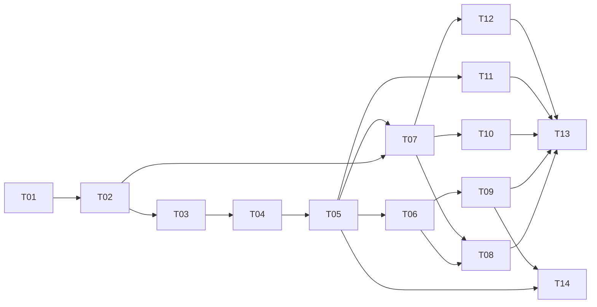

# TASKS.md: ShuttleCircle

## 1. Backlog Conventions

| Field | Rule |
|:---|:---|
| ID | Stable `TASK-XX`, never renumbered |
| Slice | End-to-end (API + screen), user-visible, dependency-ordered |
| Sources | FR-XX from PRD, AC-Fx-XX from FEATURES.md |
| Decisions | DEC-XXX cited where binding |
| Blocked | `BLOCKED:` names the owner input that is missing (DECISIONS.md, last section) and what can still be done |
| Verify | Automated test, manual check, or command |

Status is not tracked here. No task is asserted complete. Every task includes its screens at phone, tablet and desktop widths per DESIGN.md.

## 2. Dependency Graph

## 3. Task Register

### TASK-01 — Skeleton: API, Web, Database, Compose
- **Objective:** Repository layout per ARCHITECTURE.md §2. Axum service boots, connects to PostgreSQL via SQLx, applies migration `0001_init.sql` (DATABASE.md §3). Next.js app shell with design tokens, fonts and the responsive navigation frame. Compose file with `caddy`, `web`, `api`, `db`.
- **Sources:** PRD §5, §6; DATABASE.md; DESIGN.md §4, §5, §10.
- **Decisions:** DEC-006, DEC-007
- **Blocked by:** None
- **Acceptance:** `GET /api/v1/healthz` returns `200`; migration applies cleanly on an empty database; idle `api` RSS < 100 MB; the shell renders at 375, 768 and 1280 px without horizontal scroll.
- **Verify:** `docker compose up`, `curl -k https://localhost/api/v1/healthz`, `docker stats --no-stream`.

### TASK-02 — Identity & Session
- **Objective:** Guest nickname cookie; register, login, refresh rotation, logout; Google sign-in; password reset and email verification; `GET /me`; `create-superadmin` command; role extractor; rate limits.
- **Sources:** FR-01, FR-02, FR-07; AC-F1-01 to 09; API.md §1, §3.1.
- **Decisions:** DEC-001, DEC-008, DEC-020
- **Blocked by:** TASK-01
- **Acceptance:** Guest cookie is signed, HttpOnly, 30 days, no `users` row; login returns a JWT with `sub`, `role`; a reused refresh token revokes the family; OAuth `state` mismatch issues no session; suspended user cannot refresh.
- **Verify:** Integration tests for each acceptance line.
- **BLOCKED: Google OAuth client** for the Google branch and **SMTP** for reset and verification mails. Guest and email + password are verifiable now.

### TASK-03 — Match Calendar & Location
- **Objective:** Calendar (month grid or agenda by width) from 1 month back to 3 months ahead, match detail, Maps link, computed status.
- **Sources:** FR-03, FR-05; AC-F2-01 to 06; API.md §3.2.
- **Decisions:** DEC-019
- **Blocked by:** TASK-02
- **Acceptance:** Range is clamped silently; out-of-window matches absent; `status` follows the server clock; times shown in Asia/Jakarta; API p95 < 300 ms on a seeded 4-month window.
- **Verify:** Contract test; `oha`/`k6` run against seeded data.

### TASK-04 — Match Configuration & Host Assignment
- **Objective:** Create and edit match; host assignment; validation.
- **Sources:** FR-04, FR-06; AC-F3-01 to 05.
- **Decisions:** —
- **Blocked by:** TASK-03
- **Acceptance:** Invalid fields → `422`; omitted `host_id` → caller is host; host editing another's match → `403`; capacity below seats taken → `409`; price locked once a seat is held or confirmed.
- **Verify:** Contract tests plus role-matrix test.

### TASK-05 — Join Request & Manual Approval
- **Objective:** Request, withdraw, approver queue, approve, reject, with the state machine of FEATURES.md §2 and seat locking. Settlement routine with the wallet branch only (membership and reward branches arrive in TASK-09 and TASK-10).
- **Sources:** FR-08, FR-09; AC-F4-01 to 08; AC-F5-01, 02; API.md §3.3.
- **Decisions:** DEC-002, DEC-003, DEC-009
- **Blocked by:** TASK-04
- **Acceptance:** Duplicate request → `409`; only an approver may decide (`403`); sufficient wallet → `confirmed` with one ledger entry; otherwise `awaiting_payment` with a 30-minute hold; seats taken never exceed capacity.
- **Verify:** Contract tests; two parallel approvals for the last seat, exactly one succeeds.

### TASK-06 — Hold Expiry, Gateway Payment, Webhook
- **Objective:** Worker jobs for hold expiry and started matches; `pay` endpoint with Snap; webhook with signature check, wallet credit and settlement; payment page with countdown.
- **Sources:** FR-09, FR-11; AC-F5-03 to 07; API.md §3.3, §3.5; ARCHITECTURE.md §4.
- **Decisions:** DEC-002, DEC-003, DEC-010
- **Blocked by:** TASK-05
- **Acceptance:** Hold past deadline → `expired` + notification, nothing promoted; valid webhook → wallet credit then `confirmed` in one transaction; duplicate webhook has no effect; bad signature → `403`; payment after expiry stays in the wallet; an expired request can be approved again.
- **Verify:** Tests with injected clock and a Midtrans stub; one real sandbox payment end to end.
- **BLOCKED: Midtrans keys** for the sandbox check. Everything else is verifiable with the stub.

### TASK-07 — Wallet: Top-Up, Manual Credit, Adjustment
- **Objective:** Wallet screen and ledger; gateway top-up; admin manual credit that then settles held seats; superadmin adjustment.
- **Sources:** FR-13; AC-F6-01 to 05, 08; API.md §3.4.
- **Decisions:** DEC-005, DEC-010
- **Blocked by:** TASK-02, TASK-05
- **Acceptance:** Top-up writes no ledger entry before the webhook; manual credit needs amount > 0 and a note and records the admin; a credit that covers a held seat confirms it; ledger sum equals balance after mixed entries; balance never negative.
- **Verify:** Contract tests; ledger-sum property test.
- **BLOCKED: Midtrans keys** for the sandbox top-up only.

### TASK-08 — Guest → Member Conversion
- **Objective:** Blocking conversion prompt on an approved guest request; register or login links requests by `guest_sid`; settlement then proceeds.
- **Sources:** FR-10; AC-F1-04, 05; AC-F5-06.
- **Decisions:** DEC-001, DEC-004, DEC-008, DEC-009
- **Blocked by:** TASK-06, TASK-07
- **Acceptance:** Guest `pay` → `403 CONVERSION_REQUIRED`; after register the request belongs to the user and the cookie is cleared; existing email → sign in, then linked; duplicate with the member's own request → guest request cancelled.
- **Verify:** End-to-end test: guest request → approve → register → pay → `confirmed`.

### TASK-09 — History, Games, Media, Reward
- **Objective:** Member and admin history; games-played entry; media upload, view, delete; reward job and reward branch in settlement; reward switch.
- **Sources:** FR-12, FR-16; AC-F7-01 to 05; AC-F8-01 to 05; API.md §3.6.
- **Decisions:** DEC-012, DEC-015, DEC-017
- **Blocked by:** TASK-06
- **Acceptance:** Member history lists only attended matches; admin history stops at 3 months; upload by a non-host member → `403`; oversize or wrong type → `422`; fifth attended match in 2 months issues one reward expiring a month later; the sixth does not issue another; reward confirms a seat with no ledger entry; switch off stops issuing.
- **Verify:** Seeded-history tests; reward boundary tests with injected clock.

### TASK-10 — Membership & Donation
- **Objective:** Buy monthly membership from wallet; membership branch in settlement; donation.
- **Sources:** FR-15; AC-F6-06, 07.
- **Decisions:** DEC-013, DEC-014
- **Blocked by:** TASK-07
- **Acceptance:** Second purchase for the same month → `409`; a member with membership for the match month is confirmed on approval with no charge; donation above balance fails.
- **Verify:** Contract tests.
- **BLOCKED: membership price** to offer it in production; tests set the price in settings.

### TASK-11 — Notifications
- **Objective:** Notification rows written with each event; in-app list and unread badge; email outbox job with retry.
- **Sources:** FR-17; AC-F9-01 to 04.
- **Decisions:** DEC-011
- **Blocked by:** TASK-05
- **Acceptance:** Each event of AC-F9-01 writes one row in the event's transaction; a failing SMTP server does not fail the event and is retried at most 5 times; without SMTP no email is attempted.
- **Verify:** Tests with a local SMTP catcher (Mailpit).
- **BLOCKED: SMTP credentials** for real delivery only.

### TASK-12 — Finance Dashboard, Expenses, Users, Settings, Match Cancel
- **Objective:** Finance summary; expense entry; user search, role and status; settings; match cancellation with wallet refund.
- **Sources:** FR-14, FR-18; AC-F10-01 to 05; AC-F3 edge cases; API.md §3.7.
- **Decisions:** DEC-016
- **Blocked by:** TASK-07
- **Acceptance:** Summary figures match hand-computed values on seed data; superadmin cannot demote self; cancelling a match refunds each confirmed player's `paid_idr`, restores used rewards, cancels open requests and notifies all.
- **Verify:** Contract tests on a fixed seed.

### TASK-13 — Production Deploy
- **Objective:** Dockerfiles, Caddyfile with security headers, `.env.example`, backup script and cron, healthchecks, release procedure, restore rehearsal, Playwright smoke at three widths, accessibility pass.
- **Sources:** PRD §5; ARCHITECTURE.md §5, §6, §7; DESIGN.md §12.
- **Decisions:** DEC-018
- **Blocked by:** TASK-08, TASK-09, TASK-10, TASK-11, TASK-12
- **Acceptance:** Site reachable over HTTPS with a valid certificate; a dump restores into a clean database; smoke tests pass at 375, 768 and 1280 px; no WCAG AA contrast or keyboard failures on the core flows.
- **Verify:** `deploy/backup.sh` then restore; Playwright run; axe scan.
- **BLOCKED: domain and VPS details.** A staging deploy on `<ip>.sslip.io` is possible as soon as the VPS is named.

### TASK-14 — Court Rotation (latest feature)
- **Objective:** Rotation board on the match page: check-in, courts and format, per-court gender and level modes, pick by the rules, manual pick, start, finish with optional score, rest/return/leave, finished games list; finishing updates `games_played`.
- **Sources:** FR-19; AC-F11-01 to AC-F11-12; API.md §3.9; DATABASE.md migration `0003_rotation.sql`.
- **Decisions:** DEC-021
- **Blocked by:** TASK-05, TASK-09
- **Acceptance (scoring, 2026-11-20):** live +1/−1 per rally, match point at 20–x and at deuce leads, winner at 21+2 or 30, finish keeps the live score, leaderboard ranked by wins then point difference.
- **Acceptance:** With 10 checked-in players and 2 doubles courts, players who have played least are picked first; teams are 1+4 vs 2+3; a late arrival does not jump ahead; members see the board read-only; another member cannot change it (`403`).
- **Verify:** `cargo test` (rotation rule tests); `python3 deploy/test/rotation_check.py` against the test stack; manual check on a phone-width screen.

### TASK-15 — Finance Dashboard, Reports, Sandbox
- **Objective:** Wallet-page finance dashboard (pie, player bar chart, Excel and PDF report) and the dev sandbox with a fake checkout page.
- **Sources:** FR-20, FR-21; AC-F10-06 to AC-F10-09; API.md §3.7.
- **Decisions:** DEC-022, DEC-023
- **Blocked by:** TASK-12
- **Acceptance:** discrepancy is 0 after credits and expenses; players chart counts a new confirmed seat; the .xlsx opens with five sheets; printing shows only the dashboard; members get 403 on the finance endpoints; the sandbox checkout page confirms a held seat.
- **Verify:** `python3 deploy/test/finance_check.py` on the sandbox; manual pass of `deploy/sandbox/README.md`.

### TASK-16 — Manual Payment (QRIS, e-wallet, bank)
- **Objective:** Payment dialog for held seats and top-ups, payment claims, Admin > Pembayaran (confirm or reject, payment details, QRIS upload), seed script for real details kept out of git.
- **Sources:** FR-22; AC-F5-M1 to AC-F5-M5; API.md §3.7.
- **Decisions:** DEC-024
- **Blocked by:** TASK-07
- **Acceptance:** a held seat is confirmed after the admin confirms the member's claim; a rejected claim adds nothing; members cannot change payment details or confirm claims; the repository contains no real account number or QRIS image.
- **Verify:** `python3 deploy/test/payment_check.py` on the sandbox (before seeding real details).

### TASK-17 — Scoring Format and Full-Screen Counter
- **Objective:** Per-match scoring format (sets, points per set, maximum points), set-by-set live score and results, blue/red full-screen tap counter with Simpan hasil.
- **Sources:** FR-23; AC-F11-15 to AC-F11-17; API.md §3.9; DATABASE.md migration `0005_scoring_format.sql`.
- **Decisions:** DEC-025
- **Blocked by:** TASK-14
- **Acceptance:** best of 3 to 11 without deuce is won 2 sets to 1 by taps alone; a running game keeps its format when the match format changes; −1 at 0–0 reopens the last set; the saved result keeps every set and the leaderboard adds all their points; the full screen fits a phone in portrait and landscape.
- **Verify:** `cargo test`; `python3 deploy/test/rotation_check.py` and `node deploy/test/ui_rotation.cjs` on the sandbox.

<!-- SDD_SOURCE_DOCS: api,architecture,database,decisions,design,features,prd -->
